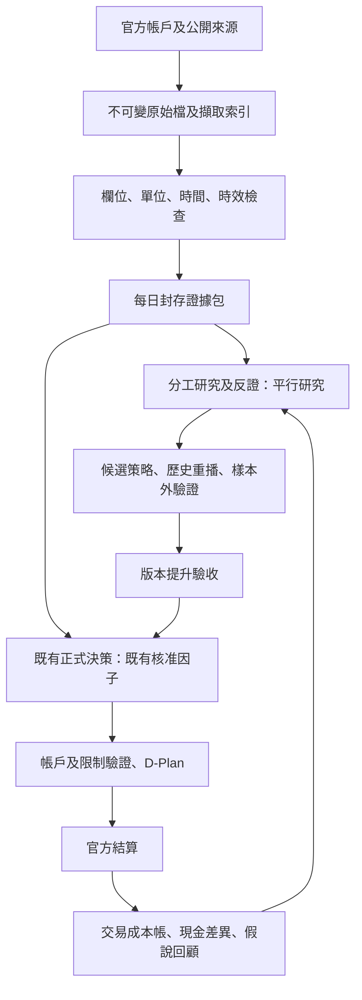

# 投資決策平台 V2：已確認設計與第一批交付

確認日期：2026-11-04。目標：正式參賽持續可用；新資料與策略先在獨立研究環境驗證。免付費、免金鑰來源優先。這份文件區分本輪實作與後續升級，不將研究可行性寫成收益證明。

## 產品決策

- 評估：成本後台股含息大盤相對績效為主；昨日持股不動為每日交易比較；官方排名與指定 ETF 為競賽監控。尚未完成含息基準 adapter 與同期績效驗證。
- 風險：平時控制相對風險，壓力情境啟動曝險調整；任何調整仍受競賽持股數、現金、白名單及個股限制約束。壓力閾值須校準，不預設任意停損百分比。
- 自主性：研究角色可提新策略；正式流程僅採經驗證、明確提升版本的策略。人不指定正式個股／權重。
- 時間：背景準備、晨間增量，08:20 可檢核候選為目標。尚未完成時限與長時間穩定性驗收，不能宣稱已有服務保證。
- 損益：移動加權成本；區分使用者附證據、重建估計、未知。官方資產維持帳戶真值，內部成本帳提供解釋與差異。

## 本輪交付

| 能力 | 實作 | 狀態／界線 |
|---|---|---|
| 第一批公開資料 | `public_context.py` | 期交所四表、央行匯率、Fed 兩個 RSS、美債名目及實質曲線。單源失敗可觀察；FRED／ALFRED 未設定 key 不呼叫。 |
| 資料契約 | source contracts | 來源 URL、單位、必要欄位、存取方式、時效、發布時間口徑、使用限制。原始回應雜湊保存。 |
| 時點與版本 | Store append-only captures | 觀測日期不等於可見時間；過去下載資料不冒充當時已知版本。最新錯誤不換成舊成功。 |
| 分工研究 | `research_board.py` | 跨市場、公司證據、組合風險、反證四節點。最多四次模型呼叫、每角色輸入與輸出封存、SQLite checkpoint。 |
| 正式流程整合 | `daily.py` | 價量→新聞→因子→跨市場事實包→既有自主決策。新增背景來源不直接改權重；可選研究失敗保留告警，核心必要檢核維持阻擋。 |
| 個股損益 | `pnl.py` | 買入含費用成本、部分賣出移動均價、已實現損益、已收股息事件、新增可交易股數事件、逐日結轉與現金差額。 |
| 工作台 | 跨市場研究、持股頁 | 來源健康、原始證據、角色報告、個股損益篩選排序、已退出部位、交易事件匯入及差異查閱。 |

## 資料流與持久化

延續現有 Python、LangGraph、SQLite、Parquet、DuckDB、FastAPI 與本地 Ollama。第一階段不為單人低頻工作流引入分散式叢集。當有多使用者、跨機同時寫入或容量壓力時，將 metadata／工作佇列遷移 PostgreSQL，原始物件遷移具版本與備份的 S3 相容儲存；分析仍使用 Parquet／DuckDB。遷移須保留物件 hash、run 身分及時點語意。

## 推理與角色協作

正式交易管線與分工研究使用不同命名空間及入口，研究報告明確 `production_authorized=false`。專員只交付主張、機制、引用、反證與未知；資產、費稅、排名與合規由程式計算。

本輪圖按角色順序執行，避免單張推理 GPU 上併發爭搶與上下文膨脹；每節點可恢復。後續可在獨立設備平行化不同資料分支，但相同模型的多角色不視為獨立佐證。模型實際來源文件、證據缺口與省略數量需可見。

反證角色獲得專員主張及其引用的原始證據，不能只閱讀共識摘要。任何角色失敗只標記該角色失敗，不無限重試，也不產生無依據的買賣指令。失敗修正需另開版本，保留舊報告。

## 決策方法升級順序

1. 對帳與歸因：先解釋資產變化、個股交易損益及殘差，建立可用的含息基準和「不交易」反事實。
2. 建立有歷史可見版本的事件特徵，區分慢頻基本面、日頻風險與即時新事件；未變資料不重新當成新訊號。
3. 產業、Beta、風格與相關性：以一致價格還原、足夠同窗樣本及可核對分類計算；資料不足即未知。不得由短期走勢猜 Beta。
4. 配置挑戰者：以分數轉換出的相對偏好、收縮共變異矩陣、換手懲罰、單檔／產業／現金限制產生候選；因子分數不能冒充預期報酬。與既有 rank-tilt 及 HOLD 使用相同成本與資料比較。
5. 效益驗證：walk-forward、封存測試、因子消融、事件延遲測試、成本敏感度、多重嘗試記錄。風險調整後優勢與壓力界線經校準才可提升。
6. ML、時序模型與 RL 只在資料及上述基線完備後評估增量；本輪不納入正式配置。

上述第 2–6 項是後續里程碑；本輪沒有宣稱完成最佳化配置、因果推斷、PIT 回測或強化學習。

## 發布及營運驗收

- 每個 run 綁定程式、模型、資料與提示版本；恢復時驗證身分，不覆寫舊結果。
- 必要風險來源無效仍停止正式產出；新增平行來源失敗留在每日進度與資料頁。
- 自動排程、08:20 交付時限、離機備份恢復、72 小時 soak 仍需分項驗收；每日整合入口與手動背景更新命令已可用。
- 官方收件、委託、成交、合規分開；本輪沒有進行官方送出。

## 2026-11-04 實測紀錄

- 九個免金鑰端點全部取得並解析成功，合計 8,848 筆觀測；FRED／ALFRED 仍未啟用。
- 本地固定模型版本完成 `board-v2-20261104-r03`：跨市場、公司證據、組合風險與反證四節點均通過輸出／引用檢查，總共四次呼叫。風險角色沒有足夠模型資料建立量化主張，保留缺口。這是工作流驗收，不是投資效益驗收。
- 最新官方結算 2026-11-03，25 檔持股成本覆蓋 25/25，全部仍為重建估計；早期現金差額約正 3.75 萬及負 3.83 萬元，沒有分配回個股或假裝對帳完成。
- 全部測試 184 passed；JS 語法及 diff whitespace 通過。瀏覽器已確認資料健康、個股查詢與損益，並檢查 390px 手機版。
- 詳細本地證據：`artifacts/llm-agent-20261027/quality-reviews/product-v2-first-batch/acceptance.json`。原始失敗研究版本保留，成功版本另建，沒有覆寫紀錄。
