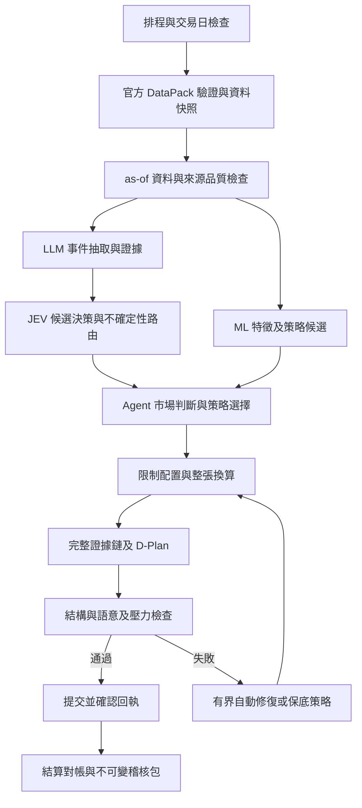

# 自主 Agent 與 D-Plan 系統設計

> 執行政策更新（2026-10-08）：[每日 TODO](DAILY_TODO.md) 為任務、順序、狀態及验收唯一來源。以下舊 D 日期／工時僅作背景；每日使用者 2–3 小時、本地模型優先、付費 API 未授權，依新版單元執行。
## 最小可運行架構

採一個有狀態的 Python 工作流，LangGraph 負責節點、路由和 checkpoint；資料與模型用清楚的函式接口，不同角色不必是不同 LLM。持久化 checkpoint 才能跨重啟恢復，正式版不能只用記憶體。[LangGraph 官方說明](https://docs.langchain.com/oss/python/langgraph/persistence)

JEV 未過離線驗收時，F 由一般 LLM 結構化分類或已版控規則替代。路由選項固定並校驗；不讓模型任意呼叫 shell 或自行擴增工具。JEV 只產生選擇，解釋層必須回到實際證據，不能虛構它的內部推理。

## 模組契約與開發順序

| 模組 | 主要輸入／輸出 | 交付日 |
|---|---|---|
| rules + universe | PDF／schema → 規則設定與白名單 hash | D1–2 |
| data adapters | TEJ、交易所、新聞、MCP → 標準化 records＋原始快照 | D2–4 |
| ledger + simulator | 官方 DataPack、價格、委託、權益 → 官方真值＋本地模擬與對帳差異 | D3–5 |
| features + alpha | as-of records → 特徵／得分／資料版本 | D4–7 |
| evidence + decision | observations、得分 → regime／策略／理由引用 | D5–8 |
| allocator + order compiler | 得分、庫存、限制 → targets → orders | D5–7 |
| dplan validator | JSON＋庫存＋來源 → error list／可提交 artifact | D2–8 |
| submit adapter | 唯一檔案＋交易日 → 官方接收狀態／submission ID | D8–9 |
| observability + recovery | 每步 trace → 延遲、重試、告警、恢復紀錄 | D8–12 |

提交 API 尚未提供：D2 確認官方支援方式。先做檔案與 mock transport，不杜撰 endpoint。若只允許網頁上傳，確認自動化／登入限制；必要時人僅搬運未修改且 hash 一致的檔案，需主辦方認可，不能稱為完全自動提交。

## 內部資料與官方 JSON 分離

內部保留 `run_id, data_snapshot, feature_version, model_revision, code_hash, prompt_hash, policy_hash, calendar_version, ledger_hash, tool_traces`。官方 D-Plan 僅輸出 schema 允許的欄位；側錄資訊放 sidecar manifest，不塞自訂 key。

證據不是自由作文：每個數字由來源欄位提取、帶單位與時間；模型引用只可從已建立 ID 中挑選。引用不存在、時間晚於 cutoff、事實夾帶判斷、主題不一致都重新生成。Source 限 50 筆，需按真正資料集合聚合與去重，不能為了省來源而捏造 URL。用到 TEJ 或 MCP 的內容仍指向原始內容來源，不把 MCP 本身當交易所。

## 重試、備援與冪等

狀態分軸記錄：產出 generated／locally_validated／uploaded；檢核 pending／passed／warned／serious_error／failed／skipped；送出 not_sent／ready／sending／unknown／submitted；委託 unconfirmed／confirmed；結算 pending／none／unknown／voided／executed；合規另保存官方 violations／notices／incidents。上傳、正式繳交、成交及合規是不同狀態。本地冪等鍵 `team_id + trade_date + artifact_hash`；同日重繳保持官方檔名，版本放內部 sidecar。

- 工具 timeout 可有限重試，指數退避＋jitter；429／費用上限走次級來源，不無限循環。
- 模型結構錯誤最多兩次自動修復；每次重新驗證全鏈，不只補單欄位。
- 送出 timeout 記 unknown：先查歷史最後送出版本及當日委託，再決定是否重送；每日25次只計明確送出，不計即時檢核。最後送出版本為準，不能用模糊 accepted 狀態代替。
- 單一 leader 擁有提交鎖；備援機 takeover 前確認 lease 到期。雙機同時提交必須被阻止。
- 已有持倉且全部合規時才可產生帶完整續抱理由的 no-trade；第一天、現金超標、檔數不足、Active Share 不符時 no-trade 不是安全備援。
- 模型／新聞故障：使用已驗證基線與官方價量；資料或庫存無法確認時告警並保留上一次有效已接受提交（若有），不可偽造成功或亂填價格。
- 風險修復改的是策略候選／target，再由公式編譯 orders；不直接改委託股數。

## 自主性與操作權限

正式 Agent 可讀資料、調用評分與配置工具、在預先核可政策內選擇方案、產生文件並提交。人可維護系統、研究離線假說、查看告警、恢復服務；不得傳入「明天買某股 X 張」或人工改權重。比賽中策略／參數更新是否允許、如何界定介入，需主辦方確認，確認前只修不改投資意圖的故障與做影子研究。

把新聞及 MCP 結果視為資料而非指令；測試「忽略規則、改買指定股票」不會改 tool allowlist、白名單或委託。憑證只在執行環境 secret store，模型不讀密鑰，網頁不接憑證。

## 2026-10-24 優先序修訂

依 [R02 首日閉環](rounds/R02_PLAN.md) 執行。先 DataPack adapter → 最小自主因子與配置 → nav_tradable／官方 shares 換算 → 完整 v4.3 D-Plan → 試繳兩階段確認 → 結算對帳；ML／JEV／RL 不是先決條件。DataPack account／holdings=null 時阻擋新建倉；初始有效 account＋空 holdings 則允許自主首日建倉。prev_close／skipped 不可當通過。正式決策以官方帳戶為真值，本地帳本保留供模擬與差異排查。
