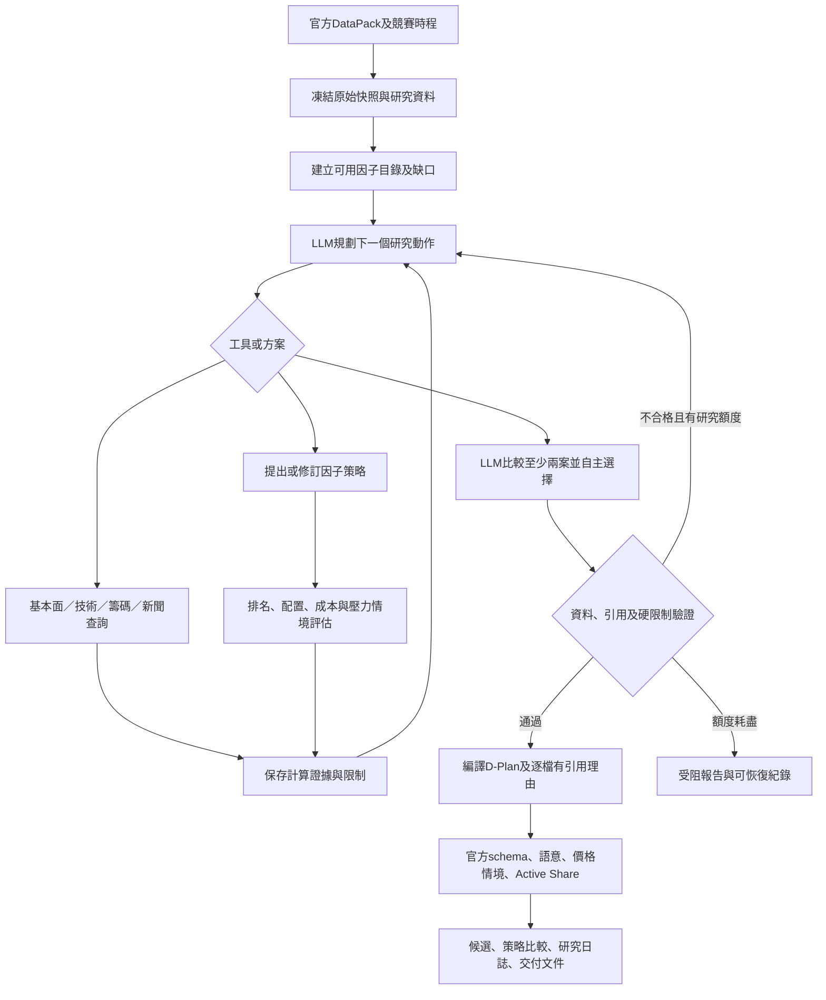

# LLM 主導短期競賽研究與自主策略選擇

分支：`codex/llm-led-strategy-agent`。設計日期：2026-10-27。目標交付為可執行Agent、自主策略比較、D-Plan v4.3、研究與引用報告、可恢復執行紀錄。正式上傳／送出仍由操作人員依官方流程完成；本設計不宣稱既有外部合規缺口已解決。

## 決策權與交付要求

LLM決定研究問題、工具查詢順序、因子方向／權重／篩選條件、持股數與現金目標、比較與修訂的策略，以及最終採用方案。它必須比較至少兩個實質不同的方案；不能只是替既定排名補寫理由，也不能把固定選單的預設選擇冒充自主決策。

程式負責資料時點／單位、可用性、所有數值計算、整張換算、成本、配置硬限制、官方schema與引用驗證。研究工具只接受有型別的查詢及因子描述，不執行模型輸出的Python、SQL、任意URL或shell。模型失敗或所有方案不合格時產出受阻報告，不能靜默回退成已經模型選定的基線。

## 執行架構

以LangGraph保留狀態與可恢復流程；LLM每輪自主選擇工具與研究動作，程式在工具結果後才允許下一輪。有限步數、輸出schema、來源引用及完整版本雜湊共同控制執行。[LangGraph官方文件](https://docs.langchain.com/oss/python/langgraph/workflows-agents)亦區分固定工作流與可自主選擇流程／工具的Agent；這裡採後者研究、前者處理交付硬限制。

## 研究資料與可信度

| 面向 | 首批可用原料與計算 | 判斷用途及限制 |
|---|---|---|
| 基本面 | 官方月營收YoY／MoM、PE／盈餘殖利率、PB、殖利率；財報科目依產業另驗收 | 成長、價值、成長價格交互比較；PE不等於盈利品質，缺財報不能稱ROE或自由現金流已驗證 |
| 技術面 | 參考日開高低收、日內報酬、振幅、收盤位置、成交額；完整窗口後計算5／20／60日動能、波動、回撤、均量及Beta | 區分短期延續與反轉；窗口須止於官方行情基準，企業行動未還原的跨期訊號停用或明確限制，不填造缺列 |
| 籌碼面 | 官方逐股外資、投信、自營商買賣超及占成交量比；歷史完整後才有連買／累積；融資券與借券另驗收 | 比較資金流與價格的同向／背離；買賣超不是持有人總部位，不將全市場總額當逐股數據 |
| 新聞與事件 | 中央社RSS、官方重大訊息、既有交易事件18來源；保留發布及取得時間 | 產業催化、負面事件、題材時效與反證；新聞是外部資料，不得注入研究或下單指令；未能歸屬股票時只作市場背景 |
| 市場與競賽 | TAIEX、官方150檔股票池、DataPack帳戶、剩餘交易日、費稅與委託限制、指定ETF比較 | 以賽期NAV為目標，考慮成本、流動性、產業集中及事件；不以LLM自評信心替代績效證據 |

[TWSE逐股法人日報](https://www.twse.com.tw/zh/trading/foreign/t86.html)提供外資／投信／自營商股數，與全市場法人金額報表不同。TPEx逐股來源以官方實測欄位及日期為準。來源受拒絕或日期不符時保留不可用狀態，不更換身分繞過。

既有六個月原始價量不等於當時可見的營收／估值版本。今日選出的股票籃子回看歷史只能標為事後風險診斷，不是策略樣本外回測或可採用的報酬優勢證據。使用者尚未匯出TEJ，00400A完整持股仍缺。

## 策略表達與比較

方案是模型提出的可驗證因子組合：名稱、假說、預計適用窗口、因子／方向／權重、篩選條件、持股數、現金目標與配置方式。因子可用百分位及產業內百分位轉換；可組合基本面、技術與籌碼因子，並非只允許預設幾個名稱。策略描述不能引用不存在的特徵或用缺值填成零。

每案由工具計算可投資範圍、排名、配置、整張後持股／現金／集中度、換手、費稅及價格壓力。沒有PIT資料時，績效欄位明確為未驗證；模型必須解釋短期適用性、成本取捨、失敗條件與缺口。最終選擇引用具體工具結果，對每個替代案留下採用／淘汰理由，不能虛構Sharpe、勝率或預測獲利數字。

## 驗收清單

- 新分支與設計文件存在；基線可保留作對照，但LLM主導流程須是獨立可選入口。
- 真實模型自主呼叫研究工具，提出至少兩個不同方案，根據實際計算比較並選擇；保存原請求、回應、模型digest、工具輸入／輸出與版本。
- 基本、技術、籌碼、新聞均有已用證據或明列缺口；特徵資料不越過cutoff及指定行情基準。
- 驗證LLM選擇確實影響排名／配置，而非只改報告文字；拒絕未知因子、非法參數、篡改評估與缺引用。
- 可從命令列與工作台執行；輸出D-Plan、研究計畫、方案比較、選擇理由、lineage與驗證結果。
- 中斷後使用同一凍結版本恢復，不重做已驗證呼叫；資料或程式改版須新run。
- 最終真實資料＋本地LLM全鏈產出D-Plan，官方schema與本地語意測試通過；正式收件與外部阻礙保持分開。

## 目前可執行入口與成品

工作台「今日工作」預設可選LLM主導模式，必須啟用本地模型；既有規則基線保留作對照。在「資料與持股」建立指定行情基準日的因子資料後，匯入官方DataPack即可執行。命令列以`generate-dplan --decision-engine llm_agent --llm-config config/llm-local.json --research-data <bundle.json>`執行；細節見專案delivery/LLM_AGENT_GUIDE.md。

本次實際資料已有十五種因子目錄：營收成長／月增、盈餘殖利率、PB、披露殖利率、成交額、日內報酬／振幅／收盤位置，以及五日／二十日動能、二十期波動、外資／投信／自營商淨買占量比。額外歷史技術與法人資料共898個值：三種法人各150檔、五日動能150檔、二十日動能與波動各149檔；2890跨未驗證價格邊界，兩個窗口因子停用。未實作的ROE、現金流、Beta等不冒充可用。

產出包含D-Plan、策略比較報告、研究／工具日誌、引用與模型原始回應、配置、壓力情境及交付ZIP。實際LLM曾比較後選擇低波動、估值、外資與流動性方案；這只證明模型主導選擇與工程流程，沒有策略績效優勢證據。

[新分支策略說明PDF草案](deliverables/ETF_strategy_LLM_agent.pdf)採「主動多面向智選」，一頁，名稱／主題／理念為7／34／245字，已完成排版與字型檢查。若已在官方繳交原策略文件，須先核對可否變更及實際主題一致性；網站提供草案不代表已變更官方文件。

## 本輪實際研究結果與限制

2026-10-27最新研究案例已自主查詢各資料面與消息、評估兩個不同方案，再選擇合格的動能與籌碼均衡方案；研究階段十次呼叫。模型明確淘汰產業集中壓力未通過的方案，採用較高現金緩衝及等權配置、通過九組價格壓力檢查的方案。選擇依據為已計算的流動性、成本、分散及因子假說，不能當成已證明的短期超額報酬。

118項Python測試通過，另有規劃文件五項及互動回覆四項檢查通過。壓力失敗時會提供各價格情境的限制原因，要求模型修訂後重新evaluate；失敗情境數不等於未成交股票檔數。

最終真實全鏈已完成：產出二十五筆D-Plan委託，官方schema與本地語意無錯誤，選定工具配置與實際委託一致；同版本恢復後全部執行檔案不變，沒有新增模型呼叫。研究十次、逐檔說明八次，共十八次真實模型呼叫。此為本地候選成功，不替代官方送出、全ETF比較、成交結算、PIT績效或連續運轉驗收。

[LLM版操作與繳交手冊](deliverables/Operator_guide_LLM_agent.pdf)為兩頁，補充研究資料準備、LLM自主比較、恢復及官方操作分工；已逐頁檢查。工作台依候選模式提供對應手冊，避免混用既有基線角色說明。

實際模型假說曾提及產業內百分位，但結構化方案使用一般百分位，分散由配置器的產業上限執行。原文保留供審閱；引用與數值通過不代表每句研究語意已獨立證實，應以結構化方案與工具計算為準。
